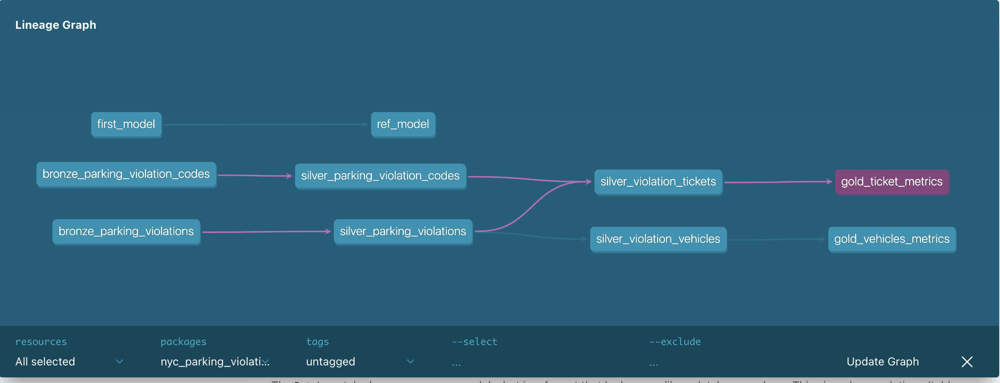
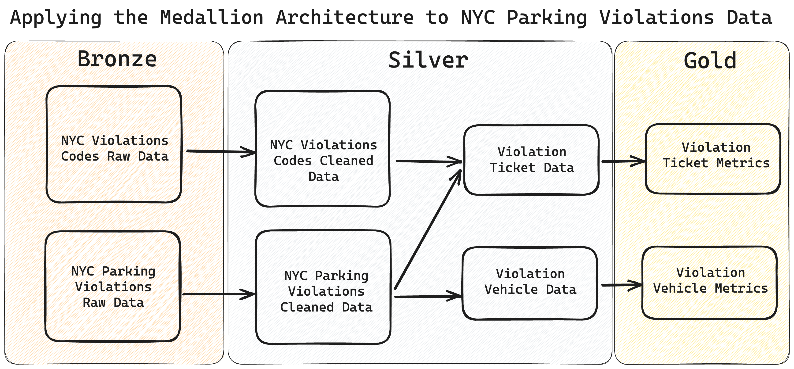

# dbt in 80/20: the 20% that covers 80% of real work

This is a working-knowledge guide to dbt, grounded in the `nyc_parking_violations`
project already in this repo. Skip the trivia — these are the concepts you'll
actually touch on a day-to-day basis.

---

## 1. The mental model: dbt only does the "T" in ELT

dbt does not extract or load data. It assumes data already landed in your
warehouse (here: DuckDB, see `nyc_parking_violations/profiles.yml`), and its
entire job is to turn raw tables into clean, tested, documented models — using
**SQL + a templating layer (Jinja) + YAML config**.

Everything else in dbt exists to support that one job:
- write a `SELECT` statement → save it as a `.sql` file → dbt turns it into a
  table/view in your warehouse.
- chain those `SELECT` statements together into a dependency graph (the DAG).
- add tests, docs, and config around that graph so it's trustworthy and
  understandable.

If you understand "a model is a `SELECT` statement that dbt materializes, and
models reference each other with `ref()`," you understand 80% of dbt.

---

## 2. Project anatomy — where things live

Looking at `nyc_parking_violations/`:

| Folder | Purpose | What you'll actually use |
|---|---|---|
| `models/` | Your `SELECT` statements (the core of dbt) | Constantly |
| `models/<layer>/schema.yml` | YAML: descriptions, tests, column docs | Constantly |
| `seeds/` | CSVs dbt loads as tables (`dbt seed`) | Occasionally — static reference data |
| `snapshots/` | Track how a mutable source changes over time (SCD Type 2) | Rarely, but important when needed |
| `tests/` | Custom data tests (singular + generic) | Often, for business-rule checks |
| `macros/` | Reusable Jinja snippets (your own SQL "functions") | Occasionally |
| `analyses/` | Compiled-but-not-run SQL (ad hoc analysis, kept in version control) | Rarely |
| `dbt_project.yml` | Project-wide config (materializations, paths) | Set once, tweak occasionally |
| `profiles.yml` | **Connection info** — which warehouse, dev vs. prod | Set once per machine/environment |

Everything in `dbt_project.yml` and `profiles.yml` is config; everything in
`models/` is where your time goes.

---

## 3. Models, `ref()`, and the DAG — the heart of dbt

A **model** is just a `.sql` file containing one `SELECT`. Example,
[`bronze_parking_violations.sql`](nyc_parking_violations/models/bronze/bronze_parking_violations.sql):

```sql
SELECT
    summons_number,
    registration_state,
    ...
FROM
    parking_violations_2023
```

The next layer, [`silver_parking_violations.sql`](nyc_parking_violations/models/silver/silver_parking_violations.sql),
builds on top of it — but instead of hardcoding the table name, it uses `ref()`:

```sql
SELECT
    ...,
    CASE WHEN violation_county = 'MN' THEN TRUE ELSE FALSE END
        AS is_manhattan_96th_st_below
FROM
    {{ ref('bronze_parking_violations') }}
```

**`ref()` is the single most important function in dbt.** It does three things:
1. Resolves to the correct database/schema name for whatever environment you're
   running in (dev vs. prod — see `profiles.yml`'s `target`).
2. Tells dbt "this model depends on that model," which is how dbt builds its
   **DAG** (directed acyclic graph) and decides run order automatically.
3. Lets `dbt docs generate` draw the lineage graph for you, e.g.
   

You almost never write `JOIN raw_table` directly — you write `JOIN {{ ref('other_model') }}`.
(The analogous function for raw source tables that dbt didn't create is
`source()` — same idea, but for your *inputs* rather than other models.)

**Practical rule of thumb:** if you're referencing another dbt model, use
`ref()`. If you ever hardcode a table name instead, you've broken the DAG and
dbt can no longer guarantee correct run order or environment portability.

---

## 4. The medallion pattern (bronze → silver → gold)

This project organizes models into three layers — a very common convention
(not a dbt feature, just folder/naming discipline):



- **Bronze** (`models/bronze/`): raw data, lightly renamed/typed, mirrors the source.
- **Silver** (`models/silver/`): cleaned, joined, business logic applied (e.g. the
  `is_manhattan_96th_st_below` flag).
- **Gold** (`models/gold/`): final, aggregated, reporting-ready
  (`gold_ticket_metrics.sql` groups by `violation_code` and sums revenue).

Each layer `ref()`s the layer below it. This gives you: a clear place to put
logic, an easy mental model for "how clean is this data," and a DAG that
visually documents your pipeline.

---

## 5. Materializations — how a model becomes a table (or not)

A model is "just a SELECT" until dbt decides *how* to persist it. That's a
**materialization**, configured in `dbt_project.yml`:

```yaml
models:
  nyc_parking_violations:
    bronze:
      +materialized: view
    silver:
      silver_violation_tickets:
        +materialized: view
      silver_parking_violation_codes:
        +materialized: ephemeral
    gold:
      +materialized: table
```

The four you need:

| Materialization | What happens | When to use |
|---|---|---|
| `view` | Creates a SQL view — no data duplication, always fresh | Cheap intermediate layers (bronze here) |
| `table` | Runs the query and physically stores the result | Final/reporting layers, expensive queries (gold here) |
| `ephemeral` | Not built in the warehouse at all — inlined as a CTE into whatever references it | Lightweight pass-through logic you don't need to query directly |
| `incremental` | Only processes *new/changed* rows on subsequent runs | Large fact tables where full rebuilds are too slow (not used in this project, but extremely common at scale) |

Config can be set at the project level (as above), or overridden per-model with
`{{ config(materialized='table') }}` at the top of the `.sql` file. The "+"
prefix in YAML means "apply to everything in this folder."

---

## 6. YAML config files — describing models, not building them

`schema.yml` files (e.g. [`models/docs/schema.yml`](nyc_parking_violations/models/docs/schema.yml))
don't generate SQL — they attach **metadata** to the models you've already
written:

```yaml
models:
  - name: bronze_parking_violations
    description: Raw data related to parking violations in 2023...
    columns:
      - name: summons_number
        description: '{{ doc("summons_number") }}'
        tests:
          - unique
          - not_null
```

Three things happen here at once:
- **Description** → shows up in generated docs.
- **`{{ doc("summons_number") }}`** → pulls a longer write-up from a `docs_block.md`
  file, so you can keep long descriptions out of the YAML (DRY documentation).
- **`tests`** → wires up data tests on that exact column (see next section).

This is the "glue" layer: SQL builds the data, YAML describes and validates it.

---

## 7. Tests — your data's guardrails

dbt tests are just assertions that run as queries; if the query returns any
rows, the test fails. Two flavors:

**Generic tests** — reusable, parameterized, declared in YAML (the example
above uses dbt's built-in `unique` and `not_null`, plus a custom one,
`generic_not_null`, defined in
[`tests/generic/generic_not_null.sql`](nyc_parking_violations/tests/generic/generic_not_null.sql)):

```sql

    select * from {{ model }} where {{ column_name }} is null

```

**Singular tests** — one-off SQL files expressing a specific business rule, like
[`tests/violation_codes_revenue.sql`](nyc_parking_violations/tests/violation_codes_revenue.sql):

```sql
{{ config(severity = 'warn') }}

SELECT violation_code, SUM(fee_usd) AS total_revenue_usd
FROM {{ ref('silver_parking_violation_codes') }}
GROUP BY violation_code
HAVING NOT(total_revenue_usd >= 1)
```
("Every violation code should generate at least $1 in total revenue — warn me
if not.")

Note `{{ config(severity = 'warn') }}` — tests can **warn** (log but don't fail
the build) or **error** (fail the build). This project also sets
`tests: +store_failures: true` in `dbt_project.yml`, which persists failing
rows to a table so you can inspect *what* failed, not just *that* something failed.

Run them with `dbt test`.

---

## 8. Jinja & macros — SQL with templating superpowers

dbt compiles `.sql` files through **Jinja** before sending them to the
warehouse. That's what `{{ }}` and `` are — Jinja expressions and
control-flow blocks. You've already seen the two most common uses:
- `{{ ref('model_name') }}` / `{{ source('source_name', 'table_name') }}`
- `{{ config(...) }}`

**Macros** (in `macros/`) are reusable Jinja functions — write SQL logic once,
call it from many models, e.g. a macro to standardize a date format or
generate a surrogate key. The custom generic test above is itself a macro
(`` is sugar over ``). You won't write many
macros early on, but recognizing `{{ my_macro(...) }}` as "a reusable snippet
defined elsewhere" will save you from confusion.

---

## 9. Seeds, snapshots, sources — the supporting cast

You'll use these far less often than `models/`, but should know what they're for:

- **Seeds** (`seeds/*.csv` + `dbt seed`): small, static, version-controlled
  reference data (e.g. a lookup table of country codes) that dbt loads as a
  table. Not for your actual production data.
- **Snapshots** (`snapshots/`): capture point-in-time copies of a *mutable*
  source so you can query "what did this row look like last Tuesday"
  (slowly-changing dimensions). This project has an empty snapshots folder —
  it's a feature you reach for only when a source table gets overwritten and
  you need history.
- **Sources** (declared in YAML, queried via `{{ source(...) }}`): a way to
  declare and document the *raw* tables dbt didn't create, so they participate
  in the DAG and freshness checks just like models do.

---

## 10. The CLI workflow — what you'll type every day

From inside `nyc_parking_violations/` (per [README.md](README.md)):

```bash
dbt debug              # verify your connection/profile is set up correctly
dbt run                # build all models (executes SQL, applies materializations)
dbt test               # run all data tests
dbt build              # run + test in dependency order (the "do everything" command)
dbt docs generate      # build the documentation/lineage site from your YAML + DAG
dbt docs serve         # serve that site locally
dbt compile            # render Jinja → SQL without executing (good for debugging)
```

Useful selectors you'll reach for constantly:
```bash
dbt run --select silver_parking_violations        # just one model
dbt run --select silver+                          # that model and everything downstream
dbt run --select +gold_ticket_metrics             # that model and everything upstream
dbt run --target prod                             # run against a different profile target
```

`profiles.yml` defines named **targets** (`dev` / `prod` here), each pointing
at a different database/path — this is how the same codebase runs safely
against different environments. `dbt_project.yml`'s `profile:` key links the
project to the right entry in `profiles.yml`.

---

## 11. Docs & lineage — "free" documentation

Because every dependency is expressed via `ref()`/`source()`, dbt can
automatically generate:
- A searchable site with every model's description, columns, and tests
  (pulled straight from your `schema.yml`/`doc()` blocks).
- An interactive DAG/lineage graph showing how data flows bronze → silver → gold.

```bash
dbt docs generate
dbt docs serve
```

This is one of dbt's biggest payoffs for very little extra work: write good
`description:` fields once, get a living data catalog for free.

---

## The 20% you just learned, restated

1. A model = a `SELECT` saved as `.sql`; dbt materializes it as a table/view.
2. `ref()` (and `source()`) wires models into a DAG — always use it instead of
   hardcoding table names.
3. Materializations (`view`/`table`/`ephemeral`/`incremental`) control how a
   model is persisted, set in `dbt_project.yml` or per-model config.
4. `schema.yml` attaches descriptions and tests to models/columns.
5. Tests (`unique`, `not_null`, custom generic, singular) are just
   pass/fail SQL queries that guard data quality.
6. `{{ }}` / `` is Jinja — `ref`, `source`, `config`, and macros are the
   building blocks you'll see everywhere.
7. `dbt run`, `dbt test`, `dbt build`, `dbt docs generate` are 90% of your
   command-line life; `--select` and `--target` cover the rest.

Everything else (seeds, snapshots, advanced Jinja, packages, exposures,
metrics) is the long tail — useful when you need it, safely ignorable until then.
